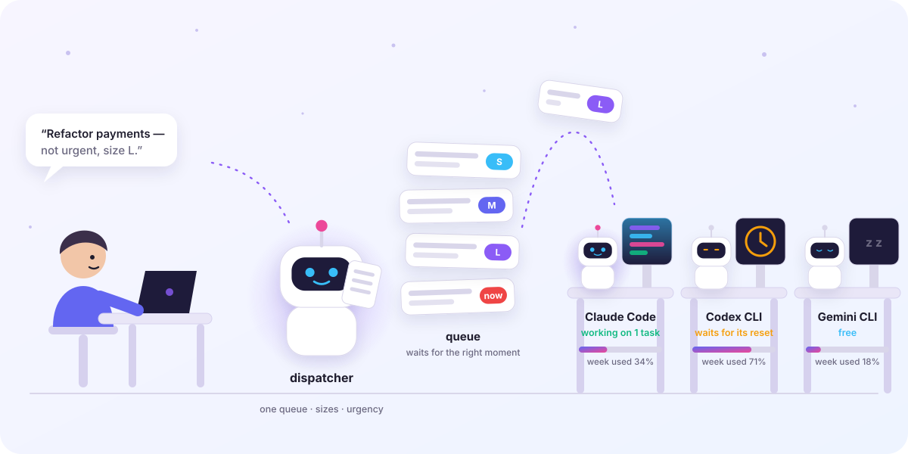
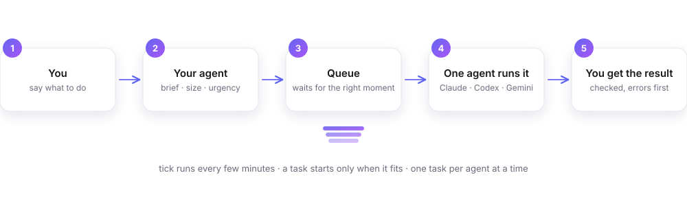
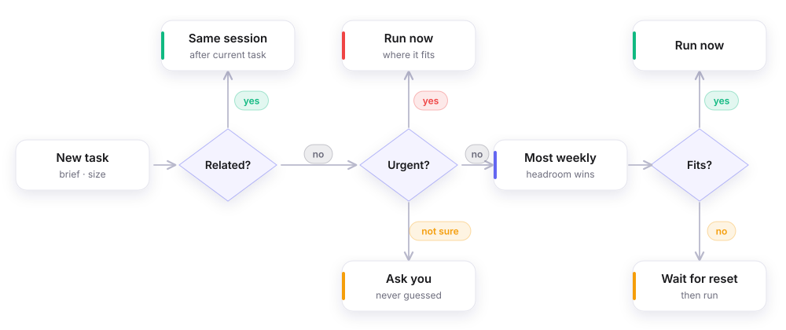
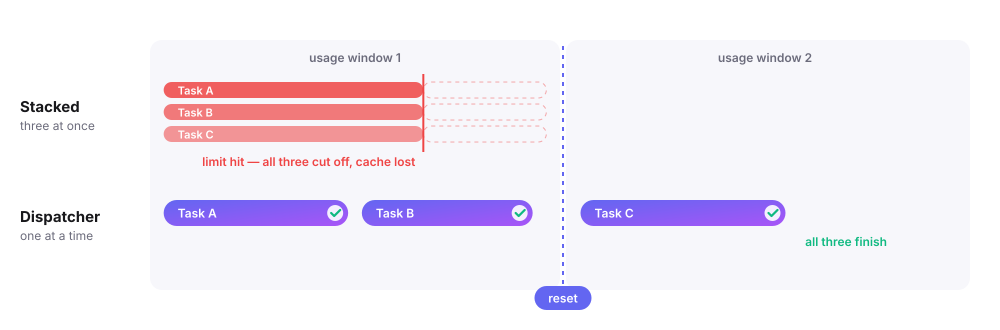
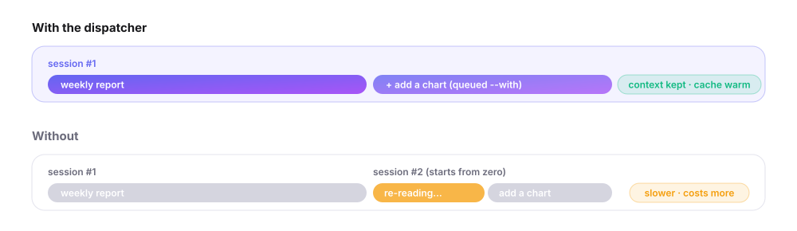

# dispatcher-tasks-for-agents

**A small task queue for AI coding agents.** You tell your agent *what* needs doing; the dispatcher decides *when*
and *where* it runs — so long tasks don't die halfway through a usage window, nothing gets forgotten, and you stop
babysitting sessions.

Works with Claude Code, Codex CLI and Gemini CLI. Plain Python 3.9+, no dependencies, runs on your own machine.

<picture>
  <source media="(prefers-color-scheme: dark)" srcset="docs/img/hero-dark.svg">
  
</picture>

> Status: in development. Claude Code support is complete; Codex CLI and Gemini CLI adapters follow their official
> docs and are marked below as verified or not.

---

## Why

If you work with coding agents every day, you know these:

| Without a dispatcher | With it |
|---|---|
| A big task starts at 80 % of your usage window and gets cut off halfway — context and prompt cache are lost. | The task waits for the window to reset, then runs start to finish. |
| You queue three things at once, they compete, and none finishes. | One task at a time per agent. The next starts when the previous one is done. |
| "I'll do that later" — and later never comes. | Later is a queue entry. It runs on its own after the reset. |
| A follow-up starts a fresh session that has to re-read everything. | Related work continues **in the same session**, with its context. |
| One plan is drained by Tuesday while another sits idle. | Non-urgent work goes to the agent with the most weekly headroom. |
| You check every few minutes whether a run finished. | Each step writes an event; your agent reads the report and tells you. |

---

## How it works

<picture>
  <source media="(prefers-color-scheme: dark)" srcset="docs/img/how-it-works-dark.svg">
  
</picture>

1. **You talk to your agent as usual.** When something should run later, in the background, or is too big for what
   is left of your window, the agent puts it in the queue: a short brief, a size (S/M/L/XL) and whether it is urgent.
2. **`tick` runs every few minutes** (launchd, systemd or cron). It looks at the queue and at each agent's limits.
3. **A task starts only when it fits** — and only if that agent isn't already busy with another queued task.
4. **When it finishes**, the run's report and an event land where your agent can read them. Your agent checks the
   result and tells you, errors first.

### Where does a task go?

<picture>
  <source media="(prefers-color-scheme: dark)" srcset="docs/img/placement-dark.svg">
  
</picture>

*Related* means it is part of work that is already running or queued.

- **Urgency is never guessed.** Broken-right-now is urgent; features, research and cleanup are not. If it's unclear,
  your agent asks you.
- **Non-urgent work always goes where the week is least used** — even if another agent happens to have room right
  now. Nobody gets drained first.
- **Waiting is a feature.** Over a week you use your plan anyway; a task that waits for a reset finishes in one piece
  instead of being cut off.

### One task at a time

<picture>
  <source media="(prefers-color-scheme: dark)" srcset="docs/img/one-at-a-time-dark.svg">
  
</picture>

Three tasks started together burn the window three times as fast and all stop mid-way. Run one after another and wait
for the reset when needed, and every one of them completes.

### Related work stays in one session

<picture>
  <source media="(prefers-color-scheme: dark)" srcset="docs/img/same-session-dark.svg">
  
</picture>

---

## Examples

What you say to your agent — and what happens:

**"Refactor the payment module, not urgent."**
→ The agent sizes it L, queues it as normal. Your window is at 85 %, so it waits; at 14:00 the window resets and the
refactor runs in one go. You get the report when you're back.

**"The login page is down — fix it now."**
→ Urgent. It starts immediately on whichever agent has room.

**"Write tests for the parser, and after that update the docs for it."**
→ Two tasks; the docs one is queued `--with` the tests one, so it continues in the same session — the agent already
knows the parser.

**"Clean up old branches."**
→ The agent isn't sure how urgent that is and asks you: *"Urgent or can it wait for the next reset?"*

**You have Claude Code and Codex CLI.**
→ Non-urgent tasks go to whichever has used less of its week; urgent ones go wherever there is room now. Each agent
uses its own sign-in — the dispatcher only starts the CLI.

---

## Install

### The easy way — ask your agent

> Install dispatcher-tasks-for-agents from https://github.com/neemphy/dispatcher-tasks-for-agents following its
> `INSTALL_FOR_AGENTS.md`.

Your agent checks the prerequisites, clones the repo, runs the tests, asks which agents to use, adds the rules to its
memory (a Claude Code skill, or a block in `AGENTS.md` / `GEMINI.md`), does a dry run and — only if you say yes —
turns on the background tick. Every decision is yours; nothing runs in the background without your OK.

### By hand

```bash
git clone https://github.com/neemphy/dispatcher-tasks-for-agents.git
cd dispatcher-tasks-for-agents
python3 -m unittest discover -s tests
python3 dispatcher.py init
```

Then follow steps 3–6 of [`INSTALL_FOR_AGENTS.md`](INSTALL_FOR_AGENTS.md).

## Commands

```bash
python3 dispatcher.py queue add <id> --brief-file brief.md --size M --normal   # or --urgent
python3 dispatcher.py queue add <id2> --brief-file next.md --size S --normal --with <id>   # related work
python3 dispatcher.py queue list        # what runs, what waits and why
python3 dispatcher.py queue show <id>   # status and last report
python3 dispatcher.py limits            # what each agent has left (when the agent reports it)
python3 dispatcher.py tick --dry-run    # what the next step would do
```

Sizes are rough shares of a usage window: **S** ≈ 3 %, **M** ≈ 10 %, **L** ≈ 25 %, **XL** ≈ 50 %. The dispatcher
learns real sizes from finished tasks.

## Supported agents

| Agent | Start | Continue same session | Limits | Verified live |
|---|---|---|---|---|
| Claude Code | ✅ | ✅ | ✅ read from the CLI | ✅ |
| Codex CLI | ✅ | per its docs | configured by you | not yet |
| Gemini CLI | ✅ | per its docs | configured by you | not yet |
| Other agents | — | — | — | [contributions welcome](CONTRIBUTING.md) |

Adding an agent means writing one small adapter: start, continue, status, report, and (optionally) limits.
See [`CONTRIBUTING.md`](CONTRIBUTING.md).

## What it does not do

- It does **not** bypass usage limits. It waits for them.
- It does **not** switch, pool or share accounts.
- It does **not** read, store or pass on passwords, tokens or API keys. Each worker is an agent CLI you are already
  signed in to, or an API key you set in your own environment.
- It does **not** modify any agent's binary.

## Terms

You are responsible for using each agent within its provider's terms. For unattended runs, providers generally
recommend API keys over consumer subscriptions. Read, for example, Anthropic's
[Consumer Terms](https://www.anthropic.com/legal/consumer-terms), [Usage Policy](https://www.anthropic.com/legal/aup)
and [Claude Code legal and compliance](https://code.claude.com/docs/en/legal-and-compliance), and the equivalent pages
for any other agent you configure.

This project is not affiliated with or endorsed by Anthropic, OpenAI or Google. "Claude Code", "Codex" and "Gemini"
are used only to describe compatibility.

## License

MIT — see [LICENSE](LICENSE).
